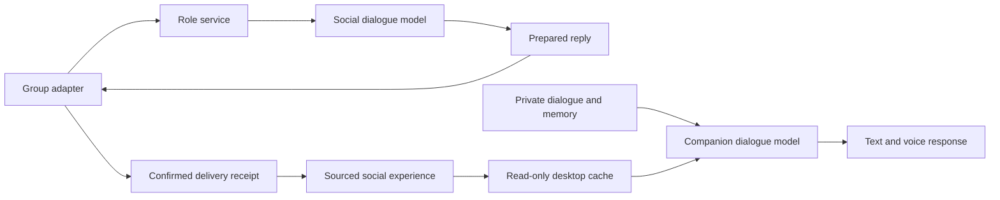

# Social roles and companion memory

**Windows update, 2026-10-18:** The independent Windows source now connects the existing QQ bot bundle to the companion cache and a current-user login task. See [Windows integration and validation](../windows/docs/SOCIAL_MEMORY.md). New WeChat group adapters and remote deployment remain unverified.

[English home](../README.en.md) · [中文说明](SOCIAL_MEMORY.md) · [HTTP protocol](SOCIAL_PROTOCOL.md#english)

A separate role service can participate in group conversations and bring permitted social summaries back to the desktop companion. Each service has a stable role ID. Sharing is configured per group, with private conversation, group records and summary caches stored separately.

**Current scope:** the root macOS source includes the optional desktop connection, service, local demo and deployment templates. A local real-model reply, delivery receipt, desktop cache synchronization and retraction have been verified. Windows now connects the existing QQ bundle, companion cache and current-user login task; see the [Windows guide](../windows/docs/SOCIAL_MEMORY.md). New WeChat group adapters and remote deployment remain unverified. Existing WeChat private chat keeps its own connection.

## Architecture and memory



| Store | Contents |
| --- | --- |
| Project `.local/data/companion.sqlite` | Existing private conversations, summaries, memories and emotion records |
| Service directory `social.sqlite` | Group events, member IDs, prepared replies, receipts, summaries and policies |
| Project `.local/data/social-cache.sqlite` | Permitted summaries, public persona and synchronization cursor |
| Project `.local/data/social-connection.json` | Role mapping, service URL, sync credential and cache settings |

Social inference uses the latest 20 events in the same group and up to 6000 characters of previous experiences from that group and participant. An experience is recorded as participation only after the channel confirms delivery. Stable IDs identify groups and people; nicknames are display labels.

The desktop **polls for increments every 15 seconds**, atomically saving each page with its cursor. Cached data stops participating in replies after **five minutes** without a successful sync. `maxContextCharacters` defaults to **6000** and accepts 100–12000; this is a character limit, not a token count.

Social references enter a separate field in the companion's existing request and count toward its full input budget. The private foreground target defaults to 200K tokens, constrained by the model window and output reservation. Social selection currently uses recency and capacity; it does not use the private-memory relevance, importance or emotion scoring. Administrators maintain the public persona.

Private conversations are not uploaded to this service. Group context goes to the configured social-model provider; shared summaries also go to the companion's dialogue provider when included in a reply. Raw group records currently have no automatic retention period.

## Run the local demo

Use the Node/npm prerequisites in [Setup](SETUP.md#english). From the repository root:

```sh
cd code/desktop-pet
npm ci
npx --no-install tsc -p tsconfig.json
node tools/pet-cloud/launch-demo.mjs
```

Open the displayed local URL. Save a synthetic private note, simulate a group message, then try pausing/resuming sync, disabling sharing and forgetting an experience. The demo uses synthetic replies with no paid inference. It needs no Live2D or T3 installation.

Data defaults to the project's `.local/social-demo/`; pass an independent directory as the final argument to override it. Ctrl+C stops the demo; restarting keeps its identity and records. The role service defaults to port 18766. If occupied, stop your previous demo or change `port` in that demo's `service.json`.

## Configure the role service

All commands below run from `code/desktop-pet/`. Initialize a dedicated service directory once:

```sh
node tools/pet-cloud/cli.mjs init ../../.local/social-service
```

This creates a stable identity and separate admin, channel and sync credentials in restricted `service.json`. Set the public name/persona as needed. Use a model endpoint supporting Chat Completions and JSON object output. Keep the API key file outside the repository with mode 0600 on macOS/Linux.

```sh
export PET_SOCIAL_MODEL_ENDPOINT='https://your-provider.example/v1/chat/completions'
export PET_SOCIAL_MODEL='your-supported-model-id'
export PET_SOCIAL_API_KEY_FILE='/absolute/path/to/private-model-key'
node tools/pet-cloud/cli.mjs serve ../../.local/social-service
```

`PET_SOCIAL_API_KEY` is also supported. The process runs in the foreground on `127.0.0.1:18766` by default. Subsequent starts use `serve` with the same data/configuration; do not reinitialize. The CLI does not register login startup.

In another terminal, from the same code directory:

```sh
node tools/pet-cloud/cli.mjs status ../../.local/social-service
node tools/pet-cloud/cli.mjs group ../../.local/social-service GROUP_ID --share
```

`--share` enables summary sharing; omit it to disable sharing, or use `--disable` to disable the group. Replies target addressed messages by default; `--all` replies to every accepted event. `maxRequestsPerDay` in `service.json` defaults to 100, counted in UTC. Update the public persona with `persona <service-directory> <JSON-file>` containing `name` and `persona`.

A real channel adapter must submit stable event/group/member IDs, claim a prepared reply, send it, then acknowledge the real receipt using the [protocol](SOCIAL_PROTOCOL.md#english). Entering a group ID alone does not connect a platform.

## Connect the desktop

Prepare the root macOS build using [Setup](SETUP.md#english), then generate its connection file on a machine holding the service configuration:

```sh
node tools/pet-cloud/cli.mjs link ../../.local/social-service ../.. http://127.0.0.1:18766
```

The second path is the **AAAAGENT repository root**. This writes `.local/data/social-connection.json` without overwriting an existing file. Restart the configured desktop to load it. After reboot, start the service and desktop with the same directories to keep their identity, cursor and data.

Use HTTPS for a remote service. Generate the connection file on a trusted machine and transfer only that restricted file to the desktop; the desktop needs only the sync credential. Absent configuration or `enabled:false` leaves the existing private companion path active. Set `enabled:false` and restart to disable the connection. Preserve `.local/` and the service directory during upgrades.

## Recovery and forgetting

Explicit model 429/502/503 responses receive at most three attempts. Ambiguous inference outcomes remain `unknown`. Explicitly unsent replies have bounded retries; ambiguous delivery waits for operator reconciliation.

```sh
node tools/pet-cloud/cli.mjs jobs ../../.local/social-service
node tools/pet-cloud/cli.mjs resolve ../../.local/social-service EVENT_ID skip
node tools/pet-cloud/cli.mjs forget ../../.local/social-service EXPERIENCE_ID
```

Other resolutions are `retry-model`, `retry-delivery` and `confirm-delivered REAL_RECEIPT_ID`; choose after checking platform state. If persona/group policy changes after a reply is claimed, the delivery receipt is retained but its outdated summary is withheld.

Forgetting retracts derived social summaries through their source dependencies, then removes corresponding desktop cache entries. Content already repeated in private chat or saved as private memory uses the companion's existing memory controls. Messages already delivered to an external platform require that platform's controls.

## Deployment and checks

`tools/pet-cloud/deploy/` includes Docker Compose and systemd templates. Copy `.env.example` into a private environment file outside the repository, fill in the model settings, then run:

```sh
docker compose --env-file /absolute/path/to/private-social.env -f tools/pet-cloud/deploy/compose.yaml build
docker compose --env-file /absolute/path/to/private-social.env -f tools/pet-cloud/deploy/compose.yaml run --rm pet-cloud init /state
docker compose --env-file /absolute/path/to/private-social.env -f tools/pet-cloud/deploy/compose.yaml up -d
```

Compose exposes the service on host loopback; add an HTTPS reverse proxy for remote clients. The systemd template assumes `/opt/AAAAGENT/code/desktop-pet`, a prepared service user, compiled code and `/etc/pet-cloud.env`. Deployment on a target cloud host remains unverified.

After compiling, run synthetic checks for isolation, delivery, deduplication, recovery, retraction, request budgeting and public connection paths:

```sh
node --test dist/tests/companion/cloud.test.js tools/pet-cloud/package-smoke.mjs
```

Code: [`companion/cloud/`](../code/desktop-pet/companion/cloud/), [`trial-backend.ts`](../code/desktop-pet/app/trial-backend.ts) and [`dialogue-request.ts`](../code/desktop-pet/providers/dialogue-request.ts). The separate Windows source now includes the optional connection while preserving its local-model extensions; its additional confirmed-participation endpoint, background tasks and permission handling are covered in the [Windows guide](../windows/docs/SOCIAL_MEMORY.md).

The public source passed full TypeScript compilation and **48 checks** across social behavior, connection paths, dialogue and context. The synthetic demo covers disconnection, restart and retraction; real group channels and remote deployment await separate validation.
