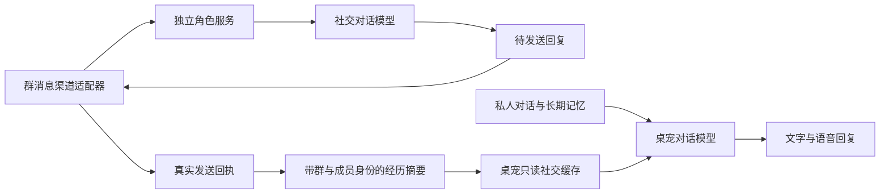

# 角色社交与桌宠记忆

[中文首页](../README.md) · [English guide](SOCIAL_MEMORY.en.md) · [接口协议](SOCIAL_PROTOCOL.md)

桌宠可以使用一个独立的角色服务参与群聊，并把允许共享的社交摘要带回私人对话。每个服务有稳定的角色 ID，每个群分别选择是否共享。私人聊天、群聊原文和社交摘要分别保存。

**当前范围：**根目录 Mac 版已接入可选社交连接；独立服务、联调页面和部署模板随源码提供。已在本机验证真实模型回复、发送回执到摘要缓存的链路和撤回。Windows 已接入现有 QQ 迁移包、桌宠缓存和当前用户登录后台任务，见 [Windows 接入与验证](../windows/docs/SOCIAL_MEMORY.md)。新微信群渠道与远程主机部署仍待验证。仓库原有微信私聊功能继续使用自己的连接。

## 架构与记忆



| 保存位置 | 内容与用途 |
| --- | --- |
| 项目 `.local/data/companion.sqlite` | 原私人对话、摘要、长期记忆及情绪记录 |
| 服务数据目录 `social.sqlite` | 群消息、群成员标识、待发送回复、回执、社交摘要与群策略 |
| 项目 `.local/data/social-cache.sqlite` | 仅缓存允许共享的摘要、公开人设和同步游标 |
| 项目 `.local/data/social-connection.json` | 角色映射、服务地址、同步凭据与缓存设置 |

社交模型读取同群最近 20 条事件，以及同群、同参与者的既有经历，经历上限为 6000 字符。只有渠道确认回复送达，才记为角色实际参与的经历；旁听消息保留在群记录中。昵称用于显示，归属使用稳定的群 ID 和成员 ID。

桌宠每 **15 秒拉取一次增量**，分页提交缓存和游标，重复读取不会重复记忆；当前实现采用定时拉取。缓存超过 **5 分钟**未成功同步便停止参与回答。默认社交参考上限 **6000 字符**，可在连接文件中设置 `maxContextCharacters`（100–12000），它是字符上限，不是 Token 数。

社交参考以单独字段进入桌宠原有对话请求，计入完整输入预算。私人上下文默认目标为 200K Token，实际受模型窗口和输出预留约束。社交摘要保留群、参与者、时间和来源；当前选择按新近程度和容量，尚未使用私人长期记忆的情绪、重要性或相关性评分。公开人设由管理员编辑。

私人对话不会上传到角色服务。群消息及其上下文会发送给所配置的社交模型；桌宠引用共享摘要时，摘要也会进入桌宠所用的对话模型请求。服务端原始群记录目前没有自动清理期限。

## 先运行本地演示

在仓库根目录执行；Node 和 npm 要求沿用 [Mac 安装说明](SETUP.md)。演示只需后端依赖和编译，无需 Live2D、T3 或真实模型凭据：

```sh
cd code/desktop-pet
npm ci
npx --no-install tsc -p tsconfig.json
node tools/pet-cloud/launch-demo.mjs
```

打开终端显示的本机地址。左栏存合成私人记录，中栏模拟群聊，右栏查看摘要。可以暂停同步、继续群聊、恢复同步，再关闭共享或遗忘经历，检查缓存变化。演示使用合成回复，无收费调用。

默认数据目录为项目的 `.local/social-demo/`；也可追加一个独立目录。按 Ctrl+C 停止，重开保留记录。默认角色服务端口为 18766；如已占用，先停止自己的旧演示，或在该演示目录的 `service.json` 中修改 `port`。

## 启动真实角色服务

以下命令均在 `code/desktop-pet/` 运行。首次初始化一次即可：

```sh
node tools/pet-cloud/cli.mjs init ../../.local/social-service
```

它生成角色身份和三类独立凭据，保存到受限的 `service.json`。把公开角色的姓名和设定改成自己需要的内容；模型使用支持 Chat Completions 与 JSON 对象输出的接口。密钥文件放在仓库外，macOS/Linux 权限设为 0600。

```sh
export PET_SOCIAL_MODEL_ENDPOINT='https://your-provider.example/v1/chat/completions'
export PET_SOCIAL_MODEL='your-supported-model-id'
export PET_SOCIAL_API_KEY_FILE='/absolute/path/to/private-model-key'
node tools/pet-cloud/cli.mjs serve ../../.local/social-service
```

也支持 `PET_SOCIAL_API_KEY` 环境变量。服务在终端前台运行，默认监听 `127.0.0.1:18766`。下一次启动继续运行 `serve`，保留原数据目录和配置，不再执行 `init`。当前 CLI 不注册开机自启。

另开终端进入同一代码目录，查看状态并启用准确的群标识：

```sh
node tools/pet-cloud/cli.mjs status ../../.local/social-service
node tools/pet-cloud/cli.mjs group ../../.local/social-service GROUP_ID --share
```

`--share` 允许该群摘要带回桌宠；省略则关闭共享；`--disable` 禁用群。默认只回复定向消息，`--all` 改为回复全部传入消息。默认每日最多 100 次社交模型请求，按 UTC 计数，可修改 `service.json` 的 `maxRequestsPerDay`。

真实 QQ／微信适配器需要按[协议](SOCIAL_PROTOCOL.md)提交稳定的事件、群和成员 ID，领取待发送回复，实际发送后再提交回执。填入群号本身不会自动连接平台。公开人设后续可用 `persona <数据目录> <JSON文件>` 更新，JSON 包含 `name` 和 `persona`。

## 让桌宠接收摘要

先按 [安装说明](SETUP.md)准备这版 Mac 桌宠，再在持有服务配置的电脑上生成连接文件：

```sh
node tools/pet-cloud/cli.mjs link ../../.local/social-service ../.. http://127.0.0.1:18766
```

第二个路径是 **AAAAGENT 仓库根目录**，不是 `code/desktop-pet`。文件生成在 `.local/data/social-connection.json`，已有文件时拒绝覆盖。重启已配置的桌宠后读取连接；开机先启动服务，再启动桌宠即可沿用身份、游标和记忆。

远端服务使用 HTTPS 地址；在受信任的机器生成连接文件后，只把该文件放到本机对应位置，保留受限权限。桌宠只需要同步凭据。配置缺席或 `enabled:false` 时使用原私人陪伴流程；把 `enabled` 改为 `false` 后重启桌宠即可关闭连接。正常升级保留 `.local/` 和服务数据目录。

## 失败恢复与遗忘

明确的模型 429／502／503 最多尝试三次；请求是否完成无法判断时保留 `unknown`。渠道明确未发出时可有限重试；发送结果未知时等待人工核查。查看并处理：

```sh
node tools/pet-cloud/cli.mjs jobs ../../.local/social-service
node tools/pet-cloud/cli.mjs resolve ../../.local/social-service EVENT_ID skip
node tools/pet-cloud/cli.mjs forget ../../.local/social-service EXPERIENCE_ID
```

其他恢复动作是 `retry-model`、`retry-delivery`、`confirm-delivered REAL_RECEIPT_ID`。只在核实平台状态后选择对应动作。回复领取后若人设或群策略改变，真实回执保留，旧摘要停止共享，避免再次发送或带回旧内容。

遗忘会沿来源依赖撤回派生社交摘要，本地缓存随后删除对应记录。已经在私人聊天里复述或另存为私人记忆的内容，使用原桌宠记忆管理处理；已发送的群消息在对应平台处理。

## 部署与开发验证

`tools/pet-cloud/deploy/` 提供 Docker Compose 和 systemd 模板。将 `.env.example` 复制为仓库外的私有环境文件，填写模型设置后运行：

```sh
docker compose --env-file /absolute/path/to/private-social.env -f tools/pet-cloud/deploy/compose.yaml build
docker compose --env-file /absolute/path/to/private-social.env -f tools/pet-cloud/deploy/compose.yaml run --rm pet-cloud init /state
docker compose --env-file /absolute/path/to/private-social.env -f tools/pet-cloud/deploy/compose.yaml up -d
```

Compose 将端口限制在宿主机回环地址；跨机器使用时在前面配置 HTTPS 反向代理。systemd 模板使用 `/opt/AAAAGENT/code/desktop-pet`，需准备服务账户、编译产物与 `/etc/pet-cloud.env`。这些模板尚未在目标云主机部署验证。

编译后执行以下合成检查，覆盖隔离、回执、去重、离线补齐、遗忘传播、预算和公开版连接路径：

```sh
node --test dist/tests/companion/cloud.test.js tools/pet-cloud/package-smoke.mjs
```

源码入口：[`companion/cloud/`](../code/desktop-pet/companion/cloud/)、[`trial-backend.ts`](../code/desktop-pet/app/trial-backend.ts)、[`dialogue-request.ts`](../code/desktop-pet/providers/dialogue-request.ts)。Windows 独立目录已经完成可选社交接线，保留原有本地模型扩展；额外的 QQ 已送达参与接口、后台任务和权限适配见 [Windows 社交说明](../windows/docs/SOCIAL_MEMORY.md)。

本次公开副本完整 TypeScript 编译通过，社交、连接路径、对话与上下文共 **48 项检查通过**。合成演示覆盖断线、重启与撤回；真实群聊和远程部署留待各渠道验证。
